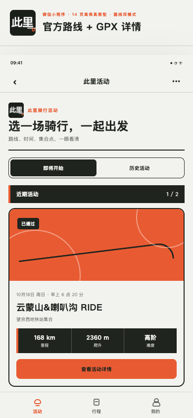
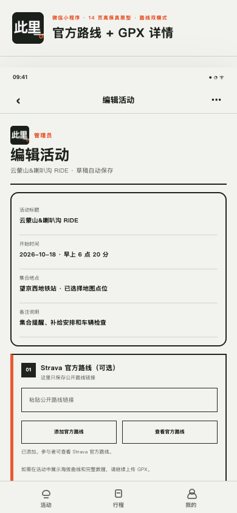
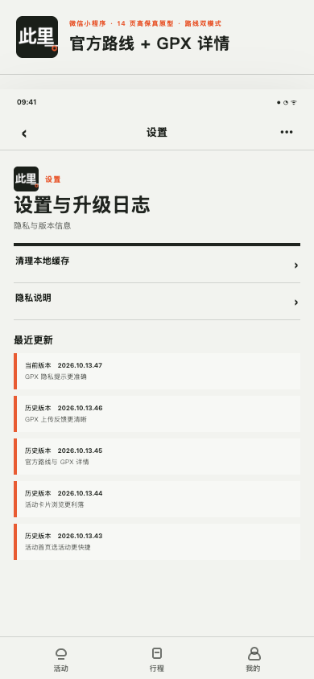

# 骑有此里（此里）· 骑行活动微信小程序

“骑有此里”是面向骑行俱乐部的原生微信小程序，覆盖活动发布、公开 Strava 路线与 GPX 详情、实名资料、报名审批、签到和个人骑行名片。小程序内使用简称“此里”。

项目基于微信云开发（CloudBase）。业务数据库集合只允许云函数访问；客户端仅可按存储规则写入与本人绑定的 `profiles/` 和 `activity-routes/` staging 路径。本地构建或测试通过不代表云端资源已经部署，也不代表真实报名旅程已经验证。

## 产品预览

- **GitHub Pages 研发交付中心**：[https://mengen-ink.github.io/cili-cycling-miniapp/](https://mengen-ink.github.io/cili-cycling-miniapp/)
- **页面范围**：项目总览、产品与需求、设计与体验、技术与架构、开发规范、测试与验收、发布与运维、版本与复盘，以及 13 个核心页面原型。
- **图片说明**：以下图片直接引用当前 UI 同步清单绑定的 Pages 效果图，不再使用历史真机或开发者工具截图。图中姓名、电话、路线编号和车辆信息均为脱敏演示数据，人物与骑行素材为 AI 生成示意图。

| 活动首页                                                                                                                             | 活动编辑与 GPX                                                                                                                           | 设置与版本说明                                                                                                     |
| ------------------------------------------------------------------------------------------------------------------------------------ | ---------------------------------------------------------------------------------------------------------------------------------------- | ------------------------------------------------------------------------------------------------------------------ |
|  |  |  |
| 浏览活动与报名入口                                                                                                                   | 配置活动信息与原生路线数据                                                                                                               | 查看版本、帮助与隐私入口                                                                                           |

预览图遵循三条维护规则：仅使用 `docs/ui-sync-manifest.json` 当前清单登记的 Pages 截图；不展示真实用户资料、凭证或受保护媒体；界面基线更新时同步更新清单、截图和本节引用。

## 已实现能力

- **活动**：公开首页默认展示未来与进行中活动，并可按服务端时间线稳定分页回看历史；已登录用户可创建和编辑本人草稿、发布与下架，并从本人的历史活动复制草稿；管理员可管理全部活动并结束活动。活动支持图集、集合地点、分组容量、后援车信息、Strava 公开路线和 GPX 原生详情。
- **报名**：微信身份、实名资料、微信授权手机号、集合方式与骑行经验；支持提交、驳回后重报、取消、审批、凭证和管理员签到。
- **路线**：管理端粘贴 Strava 公开路线链接即可免授权解析可信路线详情；活动详情页仅支持复制规范化 Strava 路线链接，不再内嵌 `web-view` / Embed；上传 GPX 后原生展示里程、升降、海拔范围、路线轮廓与海拔曲线，并支持原件下载和路线图背景。
- **个人资料**：昵称、微信授权头像、骑行背景图、称号展示和个人骑行名片。
- **通知**：报名时请求订阅授权；审批结果通过带租约和退避的 Outbox 异步发送。
- **安全与可靠性**：服务端可信 `OPENID`、管理员白名单、敏感字段 AES-256-GCM 加密、媒体 owner/canonical 校验、容量事务和操作审计。

当前不包含在线支付、第三方账号授权、管理员白名单维护界面、报名名单导出或多俱乐部租户体系。完整产品边界见 [产品需求与当前能力](docs/requirements-design.md)。

公开骑手头像默认展示，但仍只为 owner/current registry 完整匹配的 canonical 媒体签发临时地址；来源、归属、状态、内容元数据或签名校验失败时一律隐藏头像。代码和自动化验证不代表目标环境已经部署，仍须按对应不可变提交核对云函数版本、同值 `PROFILE_MEDIA_PATH_SECRET` 和真实 smoke，证据缺失时不得宣称生产就绪。

## 技术栈

- 原生微信小程序：TypeScript、WXML、WXSS
- 微信云开发：云函数、云数据库、云存储、HTTP 网关、定时触发器
- 构建与质量门禁：Node.js 24、npm、Vitest、ESLint、Prettier
- 云函数运行时：CloudBase `Nodejs20.19`
- Strava 公开路线免授权解析；服务端受限 GPX XML 解析

## 目录

```text
miniprogram/                 小程序页面、组件、仓库层和领域视图模型
cloudfunctions/              可独立部署的 CloudBase 云函数
cloudfunctions/shared/       报名领域的共享源码
cloudfunctions/route-maintenance/ 路线文件回收与历史数据迁移定时函数
scripts/                     部署准备、CloudBase bootstrap 和证据校验
tools/miniprogram-ci/        锁定版本的微信代码上传依赖
tests/                       小程序与跨模块回归测试
docs/                        产品文档、GitHub Pages 原型、部署说明与真实环境验证记录
```

`.pai/`、`.superpowers/`、`.trae/` 仅用于本地工具运行和临时工作树，必须保持未跟踪状态，不进入交付提交。

## 本地开始

前置条件：Node.js 24、npm、微信开发者工具，以及有权限的微信小程序/CloudBase 测试环境。

```bash
npm ci
npm run cloud:install
cp project.private.config.example.json project.private.config.json
npm run validate
```

然后用微信开发者工具导入仓库根目录。`project.config.json` 已声明 `miniprogram/` 和 `cloudfunctions/`；个人开发者配置写入未跟踪的 `project.private.config.json`，不要提交真实账号或环境凭据。

根目录 [`.env.example`](.env.example) 汇总本地验证、远端自动化和手动上传可能使用的变量名，`cloudfunctions/.env.example` 单独列出云函数运行时变量。两者都只提供键名和安全默认值：仓库脚本**不会自动加载 `.env`**，真实值应通过受控终端、Aime/GitHub Secret 或 CloudBase 控制台按用途注入，不得提交。

常用检查：

```bash
npm run format:check     # Markdown、JSON、TS/JS 等格式
npm run lint             # TypeScript ESLint
npm run typecheck        # TypeScript 类型检查
npm test                 # 小程序与共享领域测试
npm run test:cloud       # 各云函数与路线函数测试
npm run coverage         # 覆盖率门禁
npm run audit:all        # 根项目和云函数依赖审计
```

`npm run validate` 会串行执行格式、Lint、类型、测试、证据工具、bootstrap、部署脚本单测、云函数包和构建检查。它不连接或修改 CloudBase。

## 从开发到部署

完整配置、权限边界和故障处理见 [沙箱环境、测试、部署与代码交付配置指南](docs/sandbox-environment-configuration.md)。标准交付流程如下：

1. **同步与建分支**：检查未提交改动和 open PR，拉取最新 `origin/main`，再创建 `feat/*`、`fix/*`、`docs/*` 或 `chore/*` 分支。
2. **安装与配置**：运行 `npm ci`、`npm run cloud:install`；按需创建未跟踪的 `project.private.config.json`，并通过安全入口注入变量。
3. **开发与自测**：在微信开发者工具完成页面调试；提交前运行 `npm run validate`、`npm run coverage`、`npm run audit:all` 和 `git diff --check`。产品代码变化需同步设置页 `RELEASE_NOTES`。
4. **提交与评审**：保持相对 `main` 的单个语义提交，推送工作分支并创建 PR；PR checks 全绿后才能合入。
5. **CloudBase 变更**：涉及集合、索引或数据库规则时先运行 `npm run cloudbase:plan`，经环境负责人明确授权后再 `apply`，最后 `verify`；涉及云函数时仅部署受影响函数并执行对应 smoke。
6. **微信开发版**：PR 合入后等待 `main` CI；若变更影响小程序产物，CI 成功会触发微信开发版自动上传，纯文档/测试变更会安全跳过。
7. **体验版晋级**：开发版上传成功后，再通过 `promote-miniprogram-experience.yml` 的 `candidate -> verified` 两阶段流程人工晋级；自动上传不会覆盖体验版基线。
8. **验收与收尾**：核对 main CI、部署或安全跳过结论、必要的真机/P0 旅程证据，再删除已合并工作分支；无法执行的线上验证必须明确记录为“未执行”。

> 微信开发版上传不会部署 CloudBase 云函数、集合、索引、数据库/存储规则或网关；这些资源必须根据 diff 单独部署并回读。

## 协作与发布规则

所有变更都必须遵循 [贡献与发布规则](CONTRIBUTING.md)：基于最新 `main` 开发，本地门禁与 PR CI 通过后合入，并在 `main` CI 成功后完成自动部署验收。自动上传的设计、安全边界、首轮验证证据和故障处理见 [微信开发版 CI 自动部署方案](docs/miniprogram-ci-deployment.md)。

## GitHub Actions 自动上传微信开发版

`.github/workflows/deploy-miniprogram.yml` 会在 `main` 的 `CI` 成功后自动上传微信开发版；也支持在 Actions 页面从 `main` 手动触发并填写版本号、说明和 robot 编号。自动版本格式为 `0.0.<run_number>.<attempt>`，上传前会再次确认目标提交仍是远端 `main` 最新 head，旧 CI 重跑或非 `main` 手动运行只记录跳过，不会回退开发版。

首次启用：

1. 在微信公众平台进入“管理 → 开发管理 → 开发设置 → 小程序代码上传”，生成新的代码上传密钥。
2. 在 GitHub 仓库进入“Settings → Secrets and variables → Actions → New repository secret”，创建 `WECHAT_MINIPROGRAM_PRIVATE_KEY`，值为密钥文件的完整正文。密钥不得放入仓库、Actions variable 或日志。
3. 处理上传 IP 白名单：GitHub 托管 runner 的出口 IP 会变化。若必须开启白名单，应使用具备固定出口 IP 的受控 runner；否则需要在微信公众平台关闭该白名单，并通过主分支保护、最小 Actions 权限和定期轮换密钥补偿风险。
4. 合并工作流后，在“Actions → 微信开发版自动上传 → Run workflow”手动执行一次。确认开发版上传成功后，再依赖 `main` CI 成功后的自动触发。

手动本地上传使用同一脚本，仅通过环境变量传入密钥路径，不读取密钥正文：

```bash
npm ci --ignore-scripts --prefix tools/miniprogram-ci
MINIPROGRAM_CI_PRIVATE_KEY_PATH=/secure/private.key \
MINIPROGRAM_VERSION=1.0.29 \
MINIPROGRAM_DESCRIPTION='手动上传最新主分支' \
MINIPROGRAM_CI_ROBOT=1 \
npm run deploy:miniprogram
```

紧急停用时，在 Actions 页面禁用“微信开发版自动上传”工作流并删除 `WECHAT_MINIPROGRAM_PRIVATE_KEY`；若怀疑密钥泄露，还应立即在微信公众平台重置代码上传密钥。

## 体验版晋级与回退

体验版不会随着开发版自动上传而自动更新。当前仓库采用受证据约束的两阶段人工晋级流程：

1. 先确认目标提交仍是当前 `main`，且 `CI`、微信开发版上传与核心 smoke 均已成功。
2. 手动运行 `.github/workflows/promote-miniprogram-experience.yml`，先生成 `candidate/promote` 候选清单。
3. 由发布负责人在微信公众平台把同一开发版选为体验版，并回读版本、SHA 与入口。
4. 以同一组参数运行 `verified/promote`，再把验证后的 manifest 固化到 [`docs/releases/experience/`](docs/releases/experience/README.md)。

固定入口为 `pages/activities/index`。完整晋级、回退和长期审计规则见 [`docs/releases/experience/README.md`](docs/releases/experience/README.md)。

## 配置

以 `cloudfunctions/.env.example` 为键名清单，只在 CloudBase 控制台配置真实值：

| 变量                                                             | 使用方                                                              | 说明                                                               |
| ---------------------------------------------------------------- | ------------------------------------------------------------------- | ------------------------------------------------------------------ |
| `PII_ENCRYPTION_KEY`                                             | `profile`、`admin-review`                                           | base64 编码的 32 字节密钥；两者必须完全一致                        |
| `PROFILE_MEDIA_PATH_SECRET`                                      | `profile`、`profile-media-cleanup`、`admin-review`、`activity-read` | 至少 32 字符，四者必须一致；`activity-read` 缺失时头像 fail closed |
| `REVIEW_APPROVED_TEMPLATE_ID` / `REVIEW_REJECTED_TEMPLATE_ID`    | `notification-send`                                                 | 审批订阅消息模板                                                   |
| `WAITLIST_ENTERED_TEMPLATE_ID` / `WAITLIST_PROMOTED_TEMPLATE_ID` | `notification-send`                                                 | 候补进入与候补转正消息模板                                         |
| `ACTIVITY_REMINDER_TEMPLATE_ID`                                  | `notification-send`                                                 | 活动提醒消息模板                                                   |
| `OAUTH_RETIREMENT_PURGE_ENABLED`                                 | `route-maintenance`                                                 | 默认 `0`；仅在新链路验收、dry-run 与备份核对后临时设为 `1`         |

仓库禁止保存 secret、token、真实 `openid`、手机号、OAuth code/state、密文或真实旅程原始证据。

## CloudBase 初始化与部署

先生成只读计划，再由环境负责人审核并显式应用：

```bash
npm run cloudbase:plan
npm run cloudbase:apply
npm run cloudbase:verify
```

bootstrap 当前管理 9 个集合、29 个业务索引和全拒绝客户端数据库规则；受管定义包含活动首页与管理分页、我的行程、通知 Outbox、媒体清理以及 GPX 可信预览集合 `route_previews`。bootstrap 不创建业务活动，也不会自动应用 `cloudstorage.rules.json`。完整顺序：

1. 审阅并执行 CloudBase plan/apply/verify。
2. 按 [CloudBase 数据契约](docs/cloudbase-schema.md) 配置云函数环境变量和 `cloudstorage.rules.json`，并回读确认客户端只能写本人资料与路线 staging，canonical 媒体路径不可由客户端写入。
3. 运行 `npm run cloud:install`，再依次部署 `auth`、`profile-media-cleanup`、`admin-review`、`profile`、`activity-read`、`activity-admin`、`registration`、`notification-send` 和 `route-maintenance`。
4. 应用并回读 `cloudbaserc.json` 中的云函数触发器（小程序已不再内嵌 `web-view`，`pages/route-view` 与 `cloudfunctions/route-web` 已删除，无需配置 `/route/embed` 网关或 Embed 业务域名）。
5. 在开发者工具和真机完成官方路线、GPX 上传/保存/下载及失败回退验收；此前 `OAUTH_RETIREMENT_PURGE_ENABLED` 必须保持关闭。
6. 验收通过后临时开启 purge，等待旧账号数据与预览清空并回读，再移除该开关和线上旧资源。
7. 按 [安全初始化说明](scripts/seed-cloudbase/README.md) 创建首个管理员；活动只能通过已部署的活动管理业务流程创建。
8. 在隔离测试环境按 [P0 真实报名旅程手册](docs/verification/p0-real-registration-journey.md) 验证。缺少真实环境证据时结论只能是“未执行”，不能写成通过。

## 文档导航

- [沙箱环境、测试、部署与代码交付配置指南](docs/sandbox-environment-configuration.md)：统一说明所需 Secret、环境变量、配置方式、测试门禁和部署验收。
- [产品需求与当前能力](docs/requirements-design.md)：用户、流程、已实现范围和后续边界。
- [产品待办澄清与历史方案（2026-10-13）](docs/product-backlog-clarification-2026-10-13.md)：通知、发起人权限、活动模板、凭证与图片语义，以及已被后续单一明亮主题方案取代的历史讨论。
- [CloudBase 数据契约与安全边界](docs/cloudbase-schema.md)：集合、索引、状态机、错误码和部署后检查。
- [验证记录索引](docs/verification/README.md)：区分长期运行手册、单次发布证据和外部 CI 证据。
- [P0 真实报名旅程手册](docs/verification/p0-real-registration-journey.md)：测试环境端到端验证和脱敏证据格式。
- [固定体验版发布记录](docs/releases/experience/README.md)：体验版 `candidate/verified` 晋级、回退与长期审计规则。
- [首个管理员初始化](scripts/seed-admin/README.md)：管理员白名单的人工引导。
- [CloudBase 安全初始化](scripts/seed-cloudbase/README.md)：bootstrap、权限和首个业务数据入口。

文档以当前 `main` 的代码、配置和可复现验证为准。功能变化应在同一变更中更新对应文档；阶段性设计和执行计划完成后不长期保留在主文档树中，历史决策通过 Git 追溯。
