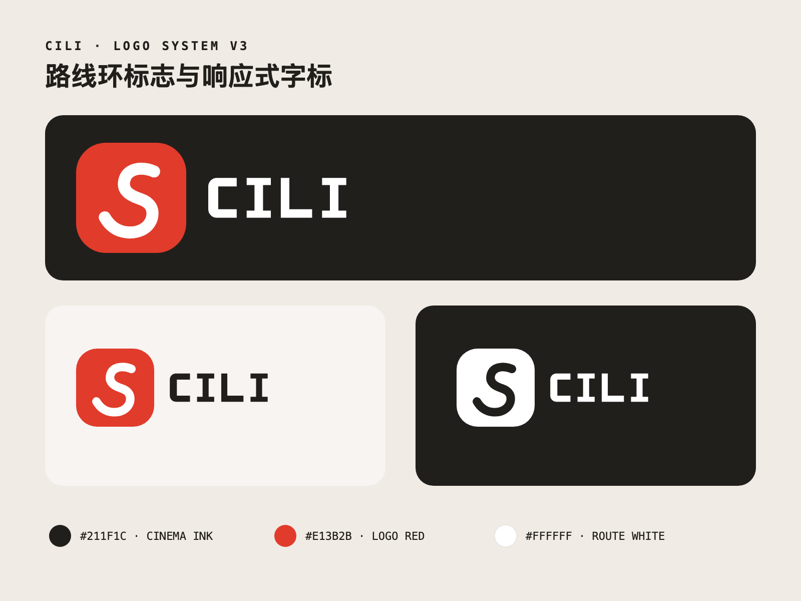

# CILI Logo 全套物料

本目录是 CILI 品牌标志的单一事实源。设计延续已确认的视觉方向：砖红圆角方章、白色路线环、等宽 `CILI` 字标；横向空间不足时只显示图标。所有字标均已转为 SVG 路径，不依赖设备字体。



## 快速使用

| 场景 | 推荐文件 | 尺寸 / 格式 |
| --- | --- | --- |
| 横版深色主标 | `generated/core/logo-horizontal-dark-1200x540.png` | 1200 × 540 PNG |
| 横版浅色主标 | `generated/core/logo-horizontal-light-1200x540.png` | 1200 × 540 PNG |
| 透明底深色主标 | `generated/core/logo-horizontal-transparent-dark-1200x540.png` | 1200 × 540 PNG |
| 透明底反白主标 | `generated/core/logo-horizontal-transparent-light-1200x540.png` | 1200 × 540 PNG |
| 微信小程序头像 | `generated/logo-wechat-144.png` | 144 × 144 PNG |
| 应用商店图标 | `generated/platform/logo-app-icon-1024.png` | 1024 × 1024 PNG |
| 社交头像 | `generated/platform/logo-social-avatar-400.png` | 400 × 400 PNG |
| 微信分享卡片 | `generated/logo-share-500x400.png` | 500 × 400 PNG |
| 照片水印 | `generated/logo-photo-watermark-360x144.png` | 360 × 144 PNG |
| 加载动效 | `generated/logo-loading-512.gif` | 512 × 512 GIF |
| 印刷交付 | `generated/print/` | PDF |
| 无损源稿 | `source/` | SVG |

## 目录结构

- `source/`：主标、图标、字标、单色稿、竖版稿、动效帧和应用模板的 SVG 源稿。
- `generated/core/`：横版、竖版、透明底、单色与独立字标 PNG。
- `generated/platform/`：微信、Apple Touch、Android、社交头像与 Favicon。
- `generated/applications/`：社交横幅、演示封面、名片、信纸与邮件签名。
- `generated/loading-frames/`：8 帧逐帧加载动画，可供不支持 GIF 的运行时使用。
- `generated/preview/`：品牌总览板。
- `generated/print/`：横版主标与总览板 PDF。
- `manifest.json`：所有导出物的尺寸、用途、字节数和 SHA-256 清单。
- `GUIDELINES.md`：留白、最小尺寸、配色、响应式切换和禁用规则。

## 品牌令牌

| 令牌 | 色值 | 用途 |
| --- | --- | --- |
| Cinema Ink | `#211F1C` | 主背景、深色字标 |
| Route White | `#FFFFFF` | 路线环、反白字标 |
| Logo Red | `#E13B2B` | 图标方章、关键强调 |
| Warm Paper | `#F7F4F2` | 浅色应用底色 |
| Muted Silver | `#B8B3BA` | 辅助说明文字 |

小程序运行时继续使用现有 `miniprogram/assets/brand/` 资产。本次物料扩展不自动覆盖运行包：主包距硬限制很近，运行时接入需要独立执行严格 UI 同步、17 路由证据与真机验收。

## 重新生成

在仓库根目录执行：

```bash
npm run logo:generate
```

生成器会重建 SVG、PNG、GIF、ICO、PDF 和 `manifest.json`。新增尺寸应修改 `scripts/generate-logo-materials.mjs` 后统一生成，禁止从 PNG 二次放大或手工覆盖清单内文件。
