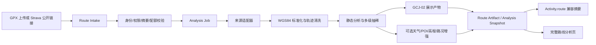

# 路线分析数据平台与开源方案

> 更新日期：2026-10-17  
> 状态：可行性方案，供后续 M0/M1/M2 实施与采购评审使用  
> 适用范围：此里骑行小程序的 Strava 公开路线与 GPX 路线分析  
> 本文只引用公开资料；价格、配额、缓存授权和服务等级在正式接入前仍须以供应商控制台、合同与工单回复为准。

## 核心判断

1. **现有 GPX 已足以构成路线分析的稳定底座。** 距离、海拔、坡度、路线轮廓和关键坡段均可在云端预计算，不应等待新的付费接口才继续建设。
2. **国内生产链路建议采用“腾讯位置服务 + 和风天气 + 自建高程数据”的组合。** 腾讯与微信原生地图坐标和运行环境最贴合；天气、地形和开放数据通过独立适配器接入，避免把全部能力绑定在一家供应商上。
3. **开放数据适合离线补充，不适合直接承担在线生产请求。** OpenStreetMap、Overpass、Copernicus DEM 和开源路由引擎具有长期价值，但公共实例通常没有面向商业产品的服务等级保证。
4. **施工、事故和封路不能在首期作强承诺。** 商业地图存在相关接口，但数据主要面向机动车道路，绿道、非机动车道和乡村骑行道路的覆盖率需要按城市实测。
5. **开源项目应按组件借鉴，暂不整体移植。** 原生微信小程序继续使用 `<map>` 与 Canvas；GPX 解析、地理计算、轨迹抽稀、高程服务和路线引擎分别选型，可显著降低包体、许可和运维风险。

---

## 一、目标与约束：现有 GPX 足以形成稳定分析底座

### 1.1 当前基础与能力缺口

项目已经具备以下基础：

- 管理端可录入 Strava 公开路线地址或上传 GPX；
- 服务端可解析 GPX，生成距离、累计升降、海拔范围、路线轮廓和海拔剖面；
- `Activity.route` 已承载路线摘要，并有独立完整路线分析页；
- GPX 原始坐标按 WGS84 理解，微信/腾讯地图展示使用 GCJ-02；
- 活动详情和完整路线分析已经共享路线轮廓与海拔视觉规则。

后续能力缺口主要集中在四类：

| 能力 | 当前状态 | 目标状态 | 是否阻断首期 |
| --- | --- | --- | --- |
| 静态路线分析 | 已有同步解析与摘要 | 异步任务、结果复用、算法版本化 | 否，可先加固 |
| 地名与沿途 POI | 依赖主办方录入或演示数据 | 商业 POI 主源 + 人工确认 | 否，字段级隐藏 |
| 天气、风和穿衣建议 | 尚未进入正式数据链路 | 按活动时间与路线分段采样 | 否，独立增强 |
| 施工、事故、封路 | 尚无稳定数据合同 | 商业事件源 + 人工复核 + 用户上报 | 否，不作强承诺 |
| 高程补全 | 主要依赖 GPX 内海拔 | GPX 优先，DEM 补全并标注来源 | 否，无海拔时部分成功 |
| 自动规划与地图匹配 | 暂不提供 | 出现明确需求后引入常驻路由服务 | 否，M2 候选 |

### 1.2 工程约束

- **坐标必须显式区分。** WGS84 用于 GPX、天气、高程、OSM 和数据交换；GCJ-02 只用于腾讯/高德及微信地图展示。禁止将转换后的 GCJ-02 写回原始 GPX。
- **小程序保持轻量。** 大文件解析、轨迹清洗、坐标批量转换和动态数据聚合放在云端；端侧只接收适合当前视图的简化结果。
- **静态与动态数据分离。** 路线几何可长期复用；天气、风和道路事件必须记录采集时间、有效期和过期状态。
- **第三方能力默认关闭。** 未取得密钥、授权、配额、缓存许可和隐私评审结论前，不进入生产关键链路。
- **动态增强失败不阻断路线。** 天气或路况不可用时，距离、海拔、路线轮廓和 GPX 下载仍应正常。
- **不把公共 Demo 当生产服务。** Overpass、Open-Meteo 免费端以及路由引擎公开实例只用于调研、PoC 或非商业验证。

---

## 二、数据源选择：国内商业地图与开放数据应组合使用

### 2.1 地图、地点与道路事件

| 方案 | 已核实能力 | 坐标与接入 | 费用/授权要点 | 推荐定位 |
| --- | --- | --- | --- | --- |
| 腾讯位置服务 | 微信小程序骑行路线、地点搜索、沿途搜索、坐标转换；另有动态交通与道路开闭能力 | GCJ-02；与微信 `<map>` 衔接直接 | 企业商业使用需确认商业授权、配额、QPS 和缓存条款；公开商业授权 FAQ 列有标准版与高级版 | 国内生产主源 |
| 高德开放平台 | 小程序骑行路线、POI、天气、坐标转换；商业交通事件与道路动态服务 | GCJ-02 | 基础 LBS 可按调用量计费；商业身份、免费额度和高级服务需控制台/合同确认 | 质量对照或灾备 |
| OpenStreetMap + Overpass | 道路、骑行设施、厕所、饮水点、维修站等开放标签 | WGS84；Overpass 是查询 API，不负责算路 | ODbL 署名及衍生数据库义务；公共实例无 SLA，不宜在线直连生产 | 离线补充与缺口检测 |

**推荐：**

- 小程序地图、地点和骑行算路优先腾讯位置服务；
- 高德作为指定城市的对照测试或灾备候选，不把两家商业 POI 响应混合沉淀成永久数据库；
- OSM 数据单独存储并记录 `source`、许可和更新时间，用于离线补充厕所、饮水、自行车维修等细粒度标签；
- POI 展示必须保留“以现场开放状态为准”，因为搜索结果不等于全天开放、免费或允许非顾客使用。

#### 道路施工、事故与封路

腾讯和高德均有事故、施工、管制、道路关闭等商业能力，但当前公开证据不足以证明其完整覆盖绿道、园路、非机动车道和乡村骑行道路。因此首期采用三层策略：

1. 使用地图供应商骑行算路结果规避其已知不可通行道路；
2. 活动发布前由组织者人工复核，并支持填写风险点；
3. 后续采购事件接口前，以真实活动城市和骑行道路样本验收覆盖率、更新延迟、位置几何、缓存与终端展示授权。

### 2.2 天气、风场与地形高程

| 方案 | 优势 | 主要边界 | 推荐定位 |
| --- | --- | --- | --- |
| 和风天气 | 国内实况、逐小时/逐日预报、风速风向、阵风、分钟降水、格点天气；人民币按量计费 | GeoAPI 与天气数据缓存规则不同；坐标基准、SLA 与商业展示条款需接入前确认 | 国内天气主源 |
| Open-Meteo | 多模型天气、风场和 Elevation API；接入简单 | 免费端限非商业使用且无可用性保证；服务器地域对大陆延迟需实测 | 研发对照或付费降级源 |
| Copernicus DEM GLO-30/GLO-90 | 全球约 30m/90m 高程，可下载后自建，在线调用成本低 | 属 DSM，树林、建筑、桥梁和隧道会带来道路高程误差 | 生产高程主数据 |
| OpenTopoData | 可将 SRTM/Copernicus 等 DEM 封装为自托管 REST 服务 | 公共实例不应视为生产 SLA；需自行维护数据和容器 | 自建高程服务层 |

#### 天气与风的采样方式

不应对每个轨迹点发起天气请求。建议按以下规则聚合：

- 路线每 5–10 km、主要海拔变化点或气象网格变化处设置采样点；
- 以活动计划开始时间推算各采样点预计到达时间；
- 将路线方位与气象风向转换为顺风、逆风和侧风分量；
- 气象风向表示“风从哪里来”，算法和文案不能反向解释；
- 页面展示来源、更新时间与有效时段，过期后只保留提示，不给出确定性结论。

#### 高程处理

- GPX 自带海拔时，以清洗后的 GPX 海拔为主，并记录处理版本；
- 无海拔时可使用 DEM 补全，状态标记为 `partial`，不让整条路线失败；
- 建议按 30–100 米采样后做中值滤波或低通滤波，再计算累计爬升；
- 累计爬升不能简单累加所有正高差，否则噪声会显著放大结果；
- 隧道、高架和桥梁段应标记 DEM 误差风险。

### 2.3 补给、卫生间与骑行服务

建议采用“商业 POI 主源 + OSM 补充 + 人工确认”的组合：

- **补给**：便利店、超市、餐饮、咖啡馆、服务区、药店；
- **卫生间**：公共厕所、商场、公园、服务区，并尽量补充开放时段和偏离路线距离；
- **骑行服务**：自行车店、维修站、打气点、医院/诊所；
- **长距离保障**：住宿、派出所、可避雨公共建筑。

OSM 可重点检索 `amenity=toilets`、`amenity=drinking_water`、`amenity=bicycle_repair_station`、`shop=bicycle`、`opening_hours=*` 和 `fee=*` 等标签。商业地图返回与 OSM 开放数据应分库存储，避免许可边界混淆。

---

## 三、开源借鉴：组件化组合优于整体照搬

### 3.1 GPX 解析与地理计算

| 组件 | 许可证 | 适合借鉴 | 主要边界 |
| --- | --- | --- | --- |
| gpxjs / GPXParser.js | MIT | GPX 1.0/1.1 字段读取、轨迹/航点/路线转统一模型 | 第三方对象不能直接成为业务模型；需自行处理分段、异常点和安全 XML |
| Turf.js | MIT | 距离、沿线采样、最近点、点线距离、偏航判断 | 按 `@turf/*` 单模块引入，避免小程序包体膨胀 |
| simplify-js | BSD-2-Clause | Douglas-Peucker 抽稀，适合生成展示级路线 | 不理解海拔、时间和语义点；必须额外保留起终点、坡顶、补给与转向点 |
| GeographicLib | MIT | 椭球面高精度距离与方位，可作为基准实现 | 普通数十公里路线通常无需引入完整 C++/WASM 栈 |
| Apache ECharts | Apache-2.0 | 海拔剖面、坡度分色、区间选择与地图游标联动 | 需使用小程序 Canvas 适配，避免高频重建全部 option |

建议建立自有中间模型，不让任何第三方库的数据结构渗入 `Activity.route`：

```ts
interface NormalizedTrack {
  coordinateSystem: 'WGS84'
  segments: Array<{
    points: Array<{
      lat: number
      lng: number
      elevationM?: number
      timestampMs?: number
      qualityFlags?: string[]
    }>
  }>
  waypoints: Array<{
    lat: number
    lng: number
    name?: string
    role?: string
  }>
}
```

清洗顺序建议固定为：安全解析 → 保留 `trkseg` → 去重 → 异常速度/跳点检测 → 海拔滤波 → 距离与坡度计算 → 分层抽稀。分析轨迹与显示轨迹必须分离。

### 3.2 路由引擎与地图渲染

| 候选 | 许可证 | 强项 | 适合阶段 |
| --- | --- | --- | --- |
| OSRM | BSD-2-Clause | 高吞吐 Route、Table、Nearest、Match；API 简洁 | 需要基础规划或地图匹配时 |
| GraphHopper | Apache-2.0 | 规划、地图匹配、高程、道路属性与自定义 profile 一体化 | M2 首选 PoC 候选 |
| BRouter | MIT | 高程感知、可配置骑行成本、路面与爬升偏好 | 骑行 profile 深度评测 |
| openrouteservice | GPL-3.0 | 多骑行 profile、Directions、Matrix、Isochrone、Snapping、POI、Elevation | 需要完整 REST GIS 能力时 |
| Valhalla | MIT | 模块化规划、Meili 匹配、Skadi 高程、多模式导航 | 长期导航平台候选 |
| MapLibre GL JS / Leaflet | BSD 系 | Web 管理端路线编辑与丰富地图图层 | 仅适合 Web/H5，不直接移植原生小程序 |

路由引擎需要预处理 OSM 图数据并常驻占用磁盘和内存，不应在普通云函数内启动。正确部署形态是：

```text
微信小程序 → CloudBase 云函数/API 网关 → 常驻路由服务 → OSM 图数据与高程缓存
```

短期只做活动路线查看和分析时，**无需部署完整路由引擎**。等出现途经点编辑、自动规划、偏航重算或道路归因的明确需求后，再让 BRouter 与 GraphHopper 并行 PoC。

### 3.3 成熟项目可借鉴点

- **gpx.studio**：借鉴多轨迹/分段编辑、地图与海拔联动、导入导出和撤销模型；不移植其浏览器 DOM 与桌面交互。
- **BRouter-Web**：借鉴骑行 profile 的产品表达、途经点编辑和路线参数模型；前端实现不进入原生小程序。
- **OsmAnd**：借鉴离线地图、偏航重算、导航状态机和路线分段；GPL 系许可证及 Android 平台决定其源码不宜直接复制。
- **OpenTracks**：借鉴暂停/恢复、传感器数据、分段统计和 GPX 语义；其 Android 服务与数据库实现不直接迁移。

#### 整套照搬的主要风险

1. Web 项目依赖 DOM、WebGL 和浏览器文件 API；Android 项目依赖后台定位、原生服务和文件系统；
2. 完整项目通常携带账户、同步、离线地图和插件等大量无关模块；
3. GPL、地图瓦片、OSM 数据和 DEM 数据具有相互独立的许可义务；
4. 通用 bicycle profile 无法替代本地禁行、闸门、路面、车流和夜骑安全样本；
5. 地图匹配是概率推断，必须同时保留原始、清洗、匹配轨迹及置信度，不能覆盖原始事实。

---

## 四、目标架构：云端预计算支撑小程序轻量展示

### 4.1 数据采集与标准化



建议将数据拆为四类：

- **Route**：路线身份、来源、内容摘要与当前版本指针；
- **RouteArtifact**：全量/详情/概览/缩略几何、基础指标和坐标转换产物；
- **RouteAnalysisSnapshot**：难度、坡段、关键点、策略等版本化结果；
- **RouteDynamicSnapshot**：天气、风、空气质量和道路事件，带 `observedAt`、`expiresAt` 与覆盖率。

`Activity.route` 在过渡期继续保留首屏摘要和旧客户端兼容字段，同时增加 `routeRef` 指向长期事实。算法升级只生成新 Snapshot，不自动改变已发布活动，需显式采用新结果。

### 4.2 缓存、降级与观测

#### 几何分层

| 层级 | 用途 | 建议规模 |
| --- | --- | ---: |
| Full | 重算、导出、精细分析 | 原始合法点，受 20 万点上限保护 |
| Detail | 地图放大浏览 | 1,000–5,000 点或按视窗分片 |
| Overview | 活动详情和完整页全览 | 200–500 点 |
| Thumbnail | 分享图与活动卡片 | 80–150 点 |

#### 降级原则

| 故障 | 用户结果 | 系统动作 |
| --- | --- | --- |
| Strava 解析失败 | 保留链接并提示上传 GPX | 熔断适配器，保留历史成功结果 |
| GPX 无海拔 | 展示地图和距离，隐藏爬升结论 | 标记 `partial`，按需异步补高 |
| GCJ-02 转换失败 | 不把 WGS84 错画到腾讯地图 | 回退静态轮廓图或隐藏地图层 |
| 天气/路况失败 | 静态路线继续可用 | 使用未超过陈旧窗口的旧值，否则隐藏模块 |
| 新算法异常 | 继续使用上一版结果 | 不切换 current 指针，停止版本晋升 |
| 队列积压 | 允许保存草稿并显示排队 | 静态任务优先，降低动态刷新优先级 |

#### 可观测指标

至少记录：

- 静态分析成功率、部分成功率与 P50/P95 耗时；
- 队列等待时间、重试和死信任务数量；
- Provider 成功率、429 比例、缓存命中率与预算水位；
- 坐标转换失败率、陈旧动态数据展示次数、降级原因；
- 孤儿对象、重复任务与算法版本分布。

日志不得记录完整 Strava URL 查询参数、原始轨迹数组、OPENID、GPX 内容或临时下载地址。

---

## 五、阶段路线：先补确定性能力再接动态数据

### 5.1 M0：静态分析加固

**目标周期：2–3 周；不依赖任何新增付费接口。**

- 统一 WGS84 主坐标与 GCJ-02 展示坐标契约；
- 将 GPX 解析改为可重试、可幂等的分析任务；
- 建立 Route、Artifact、Snapshot 与 Job 基础模型；
- 输出 Full/Overview/Thumbnail 多级几何；
- 无海拔 GPX 改为部分成功；
- Strava 公开解析封装为可替换适配器，失败时引导上传 GPX；
- 建立基础缓存、日志、指标和孤儿对象清理；
- 双写 `routeRef` 与现有 `Activity.route`，不破坏旧页面。

**验收建议：**

- 合法 GPX 静态分析成功率 ≥ 99%；
- 4 MB、5 万点以内路线 P95 完成时间 ≤ 20 秒；
- 同一内容摘要重复分析缓存命中后 P95 ≤ 2 秒；
- 国内基准路线与腾讯底图视觉偏移 P95 ≤ 20 米；
- 动态 Provider 全部关闭时，路线分析完整可用。

### 5.2 M1：地点、天气与高程增强

**目标周期：3–5 周；每个 Provider 独立过门禁。**

- 腾讯位置服务做 POI 与关键地名 PoC；
- 和风天气按路线和预计到达时间采样风场与降水；
- Copernicus DEM + OpenTopoData 建立可缓存高程补全；
- 完成坡度分段、版本化难度评分和来源/更新时间展示；
- 增加配额、预算、熔断、陈旧数据和功能开关；
- POI 结果经组织者确认后才进入活动正式路线信息；
- 实现公开路线首尾隐私裁剪，不改变原始 GPX。

**Provider 上线门禁：**正式密钥、计费/配额、缓存许可、终端展示授权、隐私评审、故障演练六项全部完成。

### 5.3 M2：路况、路线规划与规模化

**目标周期：4–8 周，按真实业务需求启动。**

- 腾讯/高德交通事件以指定城市和骑行道路样本做商务验收；
- BRouter 与 GraphHopper 并行 PoC，比较骑行 profile、坡度、路面和道路属性；
- 引入地图匹配，但保留原始轨迹和匹配置信度；
- 增加路线版本比较、批量重算、算法灰度和一键回滚；
- 建设 Provider 成本路由、数据新鲜度和任务运营看板；
- 只有出现明确需求后再评估实时导航、偏航重算和语音提示。

### 必做 PoC 清单

1. **坐标 PoC**：覆盖境内、边界与境外至少 30 条路线，验证不重复转换；
2. **GPX Worker PoC**：覆盖多段、无海拔、异常点、实体攻击、20 万点和重复投递；
3. **抽稀 PoC**：比较均匀采样与 Douglas-Peucker，验证发卡弯、闭环和折返路线；
4. **Provider PoC**：核对坐标、覆盖、限流、缓存、展示、价格和无 Key 降级；
5. **配额 PoC**：模拟预算 80%/95%/100%、429、超时、熔断和半开恢复；
6. **隐私 PoC**：验证首尾裁剪、删除生命周期、共享 Artifact 引用和日志脱敏。

---

## 六、综合判断：建议采用混合数据源并分期验证

路线分析建设可以立即开始，且首期不需要购买完整地图或导航平台。M0 应优先把 GPX、坐标、异步任务、缓存和结果版本做成稳定底座；M1 再接入腾讯 POI、和风天气与自建 DEM；M2 只在用户确实需要自动规划、道路归因或动态路况时引入商业事件数据和常驻开源路由引擎。

推荐组合如下：

- **生产地图与 POI**：腾讯位置服务；高德作为对照或灾备候选；
- **天气与风**：和风天气主源；Open-Meteo 仅作为研发对照或付费降级；
- **高程**：GPX 优先，Copernicus DEM + OpenTopoData 自建补全；
- **开放数据**：OSM/Overpass 用于离线补充和覆盖缺口检测；
- **轨迹计算**：轻量 GPX 解析器 + Turf.js 单模块 + 自有清洗/爬升逻辑；
- **地图显示**：微信原生 `<map>`；MapLibre/Leaflet 只用于未来 Web 管理端；
- **路线引擎**：短期不上；M2 优先比较 BRouter 与 GraphHopper。

该组合将确定性的静态能力留在自有系统，把费用、许可和时效敏感的外部数据隔离为可替换增强层。即使某一家供应商不可用，活动路线、距离、海拔和 GPX 仍可工作。

---

## 待验证事项

1. 腾讯商业授权实际包含的接口、QPS、缓存期限和 SLA；
2. 高德商业小程序授权、月配额与高级交通服务的合同边界；
3. 腾讯/高德骑行算路是否实时吸收施工、事故与临时封路，以及非机动车道路覆盖率；
4. 交通事件能否面向消费者展示、缓存和用于自有风险评分；
5. 和风天气经纬度输入的明确坐标基准及不同 API 的缓存权限；
6. Open-Meteo 在中国大陆的延迟、可用性和 Elevation 实际数据集；
7. OSM 在目标城市的道路、厕所、饮水与维修点完整度；
8. 自定义路线、用户轨迹、OSM 叠加、地图审图号与测绘资质的责任边界；
9. 正式集成前按锁定版本复核全部开源组件与底层数据许可证。

---

## 参考资料

### 地图、地点与道路事件

- [腾讯位置服务：微信小程序骑行路线规划](https://lbs.qq.com/miniProgram/jsSdk/jsSdkGuide/methodDirection)
- [腾讯位置服务：地点搜索](https://lbs.qq.com/search/)
- [腾讯位置服务：动态交通](https://lbs.qq.com/service/webService/webServiceGuide/dynamic%20traffic)
- [腾讯位置服务：商业授权 FAQ](https://lbs.qq.com/faq/authorizationFaq)
- [高德地图：微信小程序插件 API](https://lbs.amap.com/api/wx/reference/core)
- [高德地图：POI 搜索 2.0](https://lbs.amap.com/api/webservice/guide/api-advanced/newpoisearch)
- [高德地图：交通事件](https://lbs.amap.com/api/webservice/guide/api/Traffic-incident)
- [高德地图：道路动态信息洞察](https://lbs.amap.com/api/logistic-service/guide/inquiry-service/road-tmcstatus)
- [高德开放平台服务协议](https://lbs.amap.com/pages/terms/)
- [高德开放平台服务升级与价格](https://lbs.amap.com/upgrade#pro)

### 天气与高程

- [和风天气 API](https://dev.qweather.com/docs/api/)
- [和风天气身份认证](https://dev.qweather.com/docs/configuration/authentication/)
- [和风天气定价](https://dev.qweather.com/docs/finance/pricing/)
- [和风天气缓存建议](https://dev.qweather.com/en/docs/best-practices/cache/)
- [Open-Meteo Weather API](https://open-meteo.com/en/docs)
- [Open-Meteo Elevation API](https://open-meteo.com/en/docs/elevation-api)
- [Open-Meteo Pricing](https://open-meteo.com/en/pricing)
- [Copernicus DEM](https://dataspace.copernicus.eu/explore-data/data-collections/copernicus-contributing-missions/collections-description/COP-DEM)
- [AWS Open Data：Copernicus DEM](https://registry.opendata.aws/copernicus-dem/)
- [OpenTopoData](https://www.opentopodata.org/)
- [OpenTopography Developers](https://opentopography.org/developers)

### 开放数据与开源项目

- [OpenStreetMap Copyright and License](https://www.openstreetmap.org/copyright)
- [Overpass API](https://wiki.openstreetmap.org/wiki/Overpass_API)
- [Overpass 公共资源使用指引](https://dev.overpass-api.de/overpass-doc/en/preface/commons.html)
- [Turf.js](https://turfjs.org/docs/intro)
- [simplify-js](https://github.com/mourner/simplify-js)
- [GeographicLib](https://github.com/geographiclib/geographiclib)
- [Apache ECharts](https://echarts.apache.org/handbook/en/)
- [OSRM](https://project-osrm.org/docs/)
- [GraphHopper](https://github.com/graphhopper/graphhopper)
- [BRouter](https://github.com/abrensch/brouter)
- [openrouteservice](https://github.com/GIScience/openrouteservice)
- [Valhalla](https://valhalla.github.io/valhalla/)
- [gpx.studio](https://github.com/gpxstudio/gpx.studio)
- [BRouter-Web](https://github.com/nrenner/brouter-web)
- [OsmAnd](https://github.com/osmandapp/OsmAnd)
- [OpenTracks](https://codeberg.org/OpenTracksApp/OpenTracks)

### 合规参考

- [自然资源部、工业和信息化部：规范移动互联网应用程序中登载使用地图行为的通知](https://www.gov.cn/zhengce/zhengceku/202405/content_6950568.htm)
- [地图管理条例](https://xzfg.moj.gov.cn/law/download?LawID=421&type=pdf)
